# Mitsumete Knight (PlayStation) English translation v1.0.1

An unofficial fan translation patch for **Mitsumete Knight** (みつめてナイト).
It contains only the changes to the game's data track, not the game: you need your own
disc image of **Mitsumete Knight (Japan)** (SLPM-86068), the Redump version.

Mitsumete Knight (みつめてナイト) is a dating and life simulation with battles in a fantasy
setting. You are a foreign mercenary who spends three years in the Kingdom of Dolphan:
training, fighting its war, and getting to know sixteen women of the capital.

**[Download the patch (v1.0.1)](https://github.com/suddenlythis/mitsumete-knight-psx-english/releases/tag/v1.0.1)**
 · [How to install](INSTALL.md) · [Checksums](SHA1SUMS.txt)

  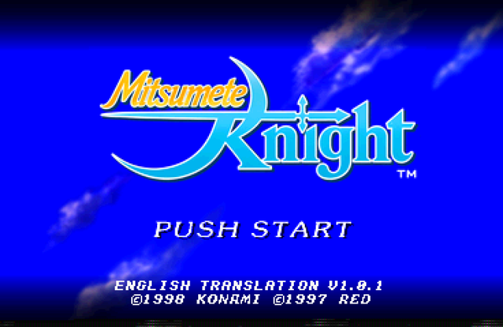

## Progress

Version 1.0.1: the script, the menus and the pictures with text are translated.

| Area | Status | Details |
|---|---|---|
| English text system | Done | The game draws Japanese characters from the console's built-in font, one per cell. The patch draws two English letters in each cell, so a line holds twice as many letters |
| Dialogue and narration | Done | All of it: the story, every heroine's scenes and dates, the war, the festivals and the endings. About 23,700 lines in all, menus included |
| Text in pictures | Done | The three maps, 213 place name plates, the rank titles, the newspaper's front page, the opening staff cards, the captions of the prologue and the ending, the battle and duel screens, and the mini-game banners. See [What is in English](#what-is-in-english) |
| Title logo | Done | A new English logo on the title screen matching the Japanese design |
| Menus and system text | Done | Weekly plan, commands, status, options, save and load, mini-game instructions, hints |
| Newspaper and glossary | Done | Every issue of the Dolphan Times and the whole in-game glossary |
| Name entry | Done | An English letter grid replaces the kana grid. Given name and surname of up to 8 letters each |
| Tested on | DuckStation | |

## About the game

Mitsumete Knight was made by KCE Tokyo, the Konami studio behind Tokimeki Memorial, together
with Red Company (Sakura Wars). It follows the same formula as Tokimeki Memorial, training your
stats week by week and courting the heroines, but moves it from a Japanese high school to a
fantasy kingdom at war, with battles and duels added.

| | |
|---|---|
| Released | 1998, Japan only |
| Publisher | Konami |
| Developer | KCE Tokyo (Konami Computer Entertainment Tokyo) with Red Company |
| Product code | SLPM-86068 |

**The story.** In April of the year 26 of the Dolphan Era a ship brings an Easterner to the
Kingdom of Dolphan, a small country in southern Europe that is hiring foreign mercenaries for
its war with neighbouring Procchia and the mercenary knights of Valpha-Valaharian. He has
three years ahead of him, a room in the mercenaries' quarters, and a small winged companion,
Piko, whom nobody else can see.

**How it plays.** Each week you choose what to train: swordsmanship, horsemanship, study,
etiquette, charm, faith, or rest. On free days you go out, visit one of the women you have
met and ask her out. Where you take her and how you answer her decide how she comes to see
you. The calendar brings festivals with mini-games, tournaments, a newspaper every month,
and, when the war flares up, battles in which you set your unit's formation and fight duels
with the enemy's Eight Generals. People can die, in the war and outside it, and what happens
to each of the sixteen heroines depends on what you do.

**The ending.** There are over 15 possible endings in the game.

## Screenshots

| | |
|---|---|
| 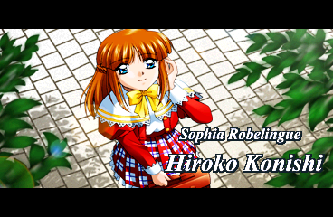 | 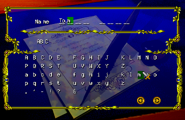 |
| 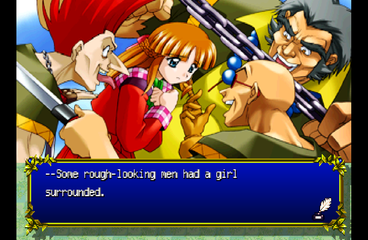 | 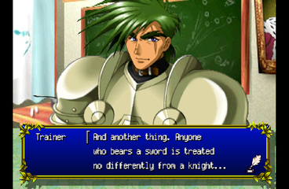 |
| 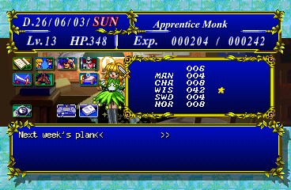 | 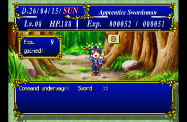 |
| 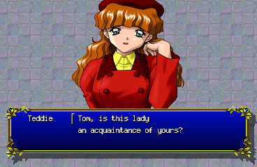 | 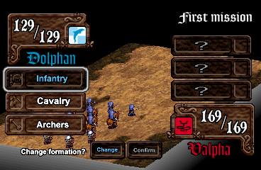 |
| 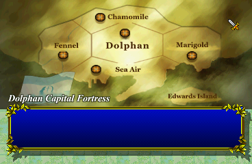 | 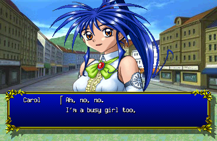 |
| 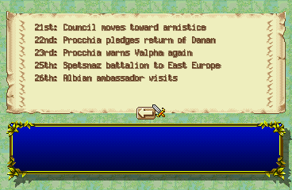 | 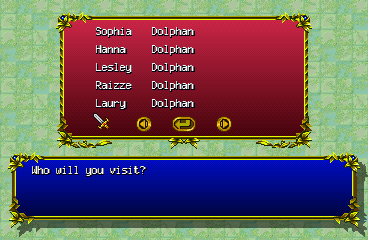 |
| 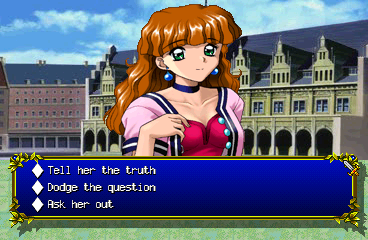 | 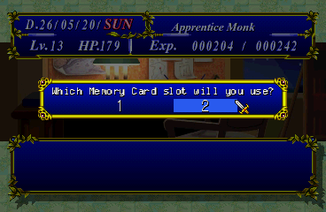 |
| 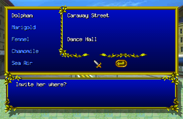 | 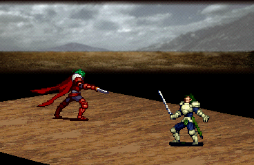 |
| 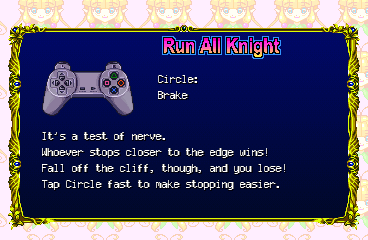 | 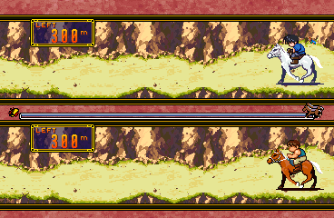 |
| 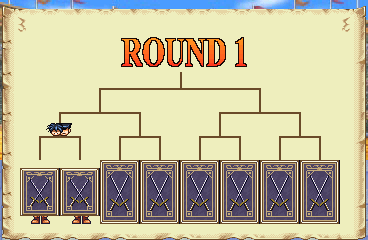 | 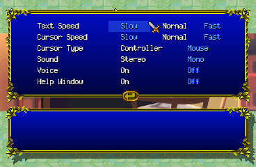 |

## Installing

You need the Redump version of the disc, **Mitsumete Knight (Japan)** (SLPM-86068): one `.cue`
and two `.bin` files. Only Track 1 is patched. It must be 666,909,600 bytes with SHA-1
`93652d280a42c73e9b382319101233d61e98a074`.

Short version: patch `Mitsumete Knight (Japan) (Track 1).bin` with the `.xdelta` file, keep
the file name, and open your usual `.cue`.

The full steps, for Delta Patcher and for the command line, are in [INSTALL.md](INSTALL.md).

**Updating from v1.0.** Patch the original Japanese Track 1 again, not the file you patched with
v1.0. Saves made in the game with v1.0 should still work. Emulator save states made with v1.0 may
keep some of the old text, so load the game normally instead.

Start a new game after patching. A save made with the Japanese game stores the hero's name in
Japanese letters, which the English game cannot show properly.

## About this translation

**Tone.** The script keeps the tone of the original: a light, often funny courtship game set
against a war that is not light at all. Nothing has been toned down and nothing made harsher.
Each of the sixteen heroines keeps a voice of her own.

**Names.** See [Names used in this patch](#names-used-in-this-patch) below.

**"The Easterner".** The game's own English captions call the hero "an Asian". The patch
uses "Easterner" (東洋人) there and throughout, and the two caption sequences were redrawn to
match.

**Voices.** The voice acting is kept. The English of the voiced lines follows the recordings,
pausing where the actors pause.

**No honorifics.** There are no Japanese honorifics. The relationship is carried by the
wording instead.

AI was used to assist with the code and translation.

## Names used in this patch

There has been discussion about what characters names are in English, some of what people accept
and mention online may not be correct. For example, "Priscila" is the name given in official
documentation around the game including the game instruction manual but "Priscilla" is used in online
discussions. Where Konami published a name in English in a manual or official guide, the patch has
used that spelling. Where it did not, the patch uses its own reading.

**The heroines**

| Name in the patch | Japanese | Why |
|---|---|---|
| Priscila Dolphan | プリシラ・ドルファン | The game instruction manual prints "Priscila" with one l, and "Dolphan" as the kingdom's name. "Priscila" with one l also appears in the official guidebook from Konami |
| Sophia Robelingue | ソフィア・ロベリンゲ | Printed in English in the official guidebook from Konami and on Konami's CDs. Not "Roberinge" |
| Laury Callwell | ロリィ・コールウェル | "Laury" is printed in the manual, "Callwell" in the guidebook. Not "Lolly" or "Colwell" |
| Hanna Shawski | ハンナ・ショースキー | "Hanna" is printed in the manual. The guidebook shows "Shaw...", and the ending follows the spelling fans already use |
| Lesley Lopicana | レズリー・ロピカーナ | "Lesley" is printed in the manual |
| Linda Zakroid | リンダ・ザクロイド | Printed in the guidebook. Not "Zakuroid": the extra vowel is only how Japanese writes it |
| Raizze Haimer | ライズ・ハイマー | "Raizze" is printed in the manual, "Haimer" in the guidebook. Not "Rize" or "Heimer" |
| Gene Petromolla | ジーン・ペトロモーラ | "Gene" is printed in the manual. Not "Jean" |
| Teddie Adelaide | テディー・アデレード | "Teddie" is printed in the manual |
| Carol Palecki | キャロル・パレッキー | "Carol" is printed in the manual. The guidebook shows "Pale...", and the ending follows the spelling fans already use |
| Claire Majoram | クレア・マジョラム | Printed in full in the guidebook. Not "Marjoram", even though the name comes from the herb |
| Sue Grafton | スー・グラフトン | "Sue" is printed in the manual |
| Sarah Pixis | セーラ・ピクシス | "Sarah" is printed in the manual. Not "Sera" |
| Menesys | メネシス | Printed in the manual. Not "Nemesis" |
| Anne | アン | Printed in the manual |
| Noel Ashetta | ノエル・アシェッタ | "Noel" is printed in the manual |

If you know of an official spelling that differs from one used here, please say so.

## What is in English

- All dialogue and narration, with each character's voice kept: the heroines' stories and
  dates, the war, the festivals, the newspaper, the glossary and every ending.
- Menus and system messages: the weekly plan, commands, status, options, save and load,
  mini-game instructions, the fortune teller and the church.
- The name-entry and birthday screens, as English grids.
- The title logo.
- Pictures with text, redrawn in English:
  - the three maps (the capital, the Torcchia region and the world)
  - 213 place name plates
  - the player's rank titles in the status bar
  - the front page of the Dolphan Times
  - the sixteen opening credit cards, with each character's name and her voice actor's
  - the caption sequences of the prologue and the ending
  - the battle screen (unit labels, formation prompt), the battle titles on the map, and the
    duel name plates and commands
  - the mini-game title banners, the horse race's labels, the Sword Tournament's banners
    (ROUND 1, FINAL, VICTORY, DEFEAT, CHAMPION) and the sign of the tutor's test
  - the block puzzle's title logo, "Puzzle Knight", with its animation, and the twenty names on
    its opponent list
  - the logo on the sixteen pictures shown after the heroines' endings

## What was changed in the game

Nothing about the rules, the story, the calendar or the content was changed.

Text
- The game draws one Japanese character per cell from the console's built-in font. The patch
  makes each cell hold two English letters from a font of its own, and removes the extra gap
  the game puts between cells in running text.
- Strings that came out longer than the Japanese were moved and the scripts' references to
  them updated. About 140 archive files grew and were moved to the end of the archive.
- A newspaper or glossary page holds 8 lines of 48 letters, up from 6 lines of 20 characters.

Interface
- The name-entry screen uses an English grid. Each name can be up to 8 letters.
- The Options screen's labels and choices were realigned for the English words.
- The time of day on outings reads Morn, Noon, Eve, Night.

Pictures
- See the list above. The two caption sequences, the opening credit cards and the duel name
  plates were laid out afresh. The others were redrawn in place.

## Not translated

- The staff roll at the end, and the block puzzle's own staff list.
- The title of the save file as the console's memory card manager shows it.
- One large brush-written character used as a duel special-move effect, kept as artwork.

## Known issues and limits

- The font is fixed-width: every letter has the same slot.
- On the name-entry and birthday screens, labels longer than two letters show a small gap
  every two letters ("Na me", "Ne xt"). The grid itself works normally.
- Choosing an empty square of the name grid enters a blank, which can leave a gap in a name.
- A few notices that insert a name into a sentence leave a space before the punctuation
  ("It's Sports Fest .").
- The glossary's index keeps the Japanese order, with the rows labelled in romanised kana
  (A, Ka, Sa, Ta...).
- Some labels are abbreviated to fit their slots (for example "Etiq." for Etiquette).
- If a choice does not react to Circle, press Up or Down first.

## Technical

- One file of the disc image is changed: Track 1, the data track. It stays the same size.
  Track 2, the audio track, is untouched.
- The patch is made against the Redump image (Track 1 SHA-1 `93652d280a42c73e9b382319101233d61e98a074`) and refuses any
  other file.
- Emulator save states made on the Japanese game keep the old program and text in memory.
  Load the game normally instead.

## Version history

| Version | Date | Notes |
|---|---|---|
| v1.0.1 | 2026-11-25 | The heroines' profiles at the church, three letter titles and the block puzzle's logo and names are now in English, as is the logo on the pictures after the endings. See the release notes below |
| v1.0 | 2026-11-24 | First release. Full script, menus, newspaper and glossary, English name entry, a new title logo and the pictures with text |

### Release notes: v1.0.1

Fixed
- The heroines' profiles at the church were still in Japanese. All sixteen are now in English,
  with every page, the Love and Worry labels and the messages for heroines who are missing or
  cannot be visited.
- Three letter titles were still in Japanese ("Tutor Wanted", "Tipoff" and "Invite").
- A few short lines and labels elsewhere that were still in Japanese.

Pictures
- The block puzzle's title logo is now "Puzzle Knight", with the original animation.
- The twenty names on the block puzzle's opponent list are now in English.
- The sixteen pictures shown after the heroines' endings now carry the English logo.
- The title screen shows the version number, v1.0.1.

Thanks to Denshadego for reporting the church profiles and the letter title.

---

This is an unofficial, non-commercial fan work. Mitsumete Knight and everything in it belong
to their owners. The patch contains no game data that can be used without an original disc
image.
